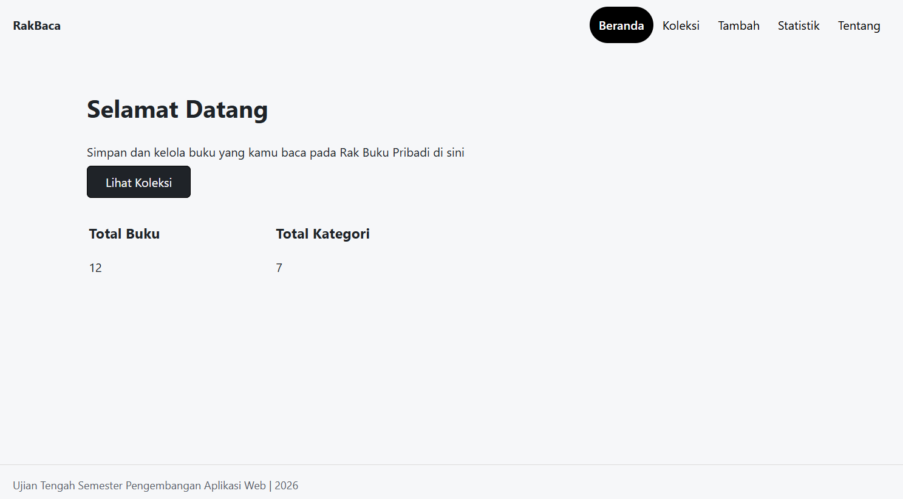

# RakBaca

- Nama: JUNDI LAMTARA
- NIM: 124140190
- Kelas: RB
- Tema: Rak Buku Pribadi
- Deployment: https://jey-el.github.io/uts-paw/

## Screenshot Web



## Fitur

- Dapat menambah, menghapus, dan menyimpan buku yang dimiliki, sedang dibaca, atau ingin dibeli
- Statistik dan ringkasan total buku dan kategorinya
- Terdapat laman Tentang yang berisi profil saya

## Menjalankan secara lokal

```bash
cd app
npm install
npm run dev
```

## Konsep React yang dipakai

- Hook (`useLocalStorage`, `useKoleksi`)
- Context (`createContext`, `koleksiContext`, `koleksiProvider`, `useContext`)
- React Router (`Link`, `useParams`, `useNavigate`, `NavLink`, `Route`, `Routes`)
- State (`useState`, `useEffect`)
- Component (`Layout`, `KotakPencarian`, `KartuItem`, `JumlahBuku`, `JumlahKategori`)